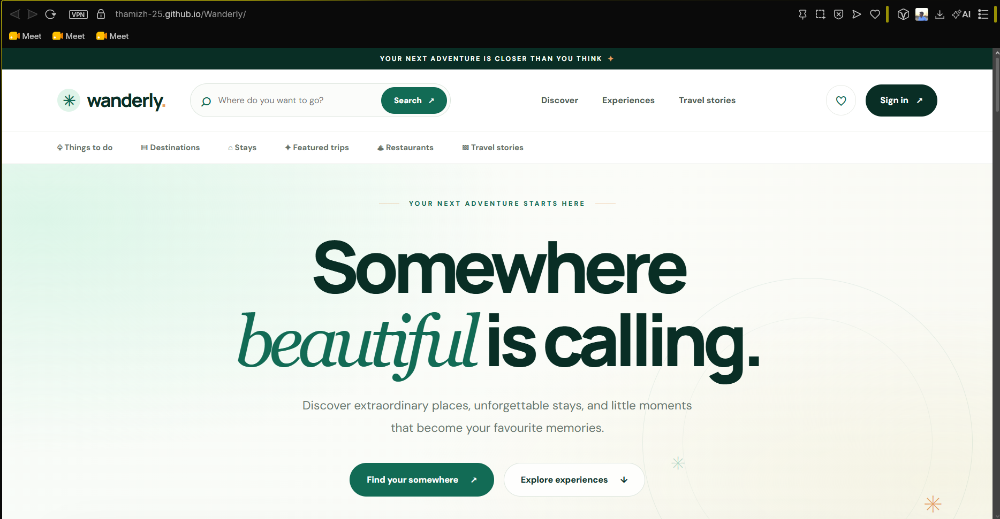
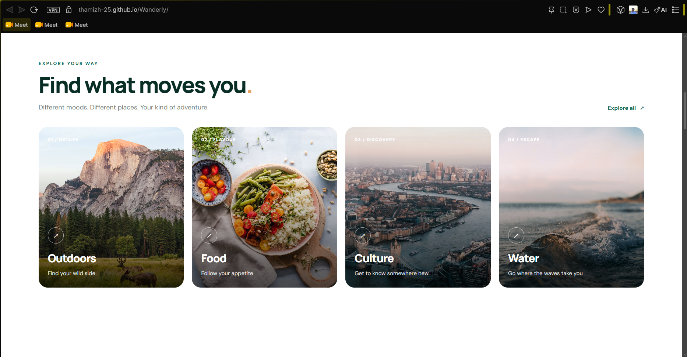
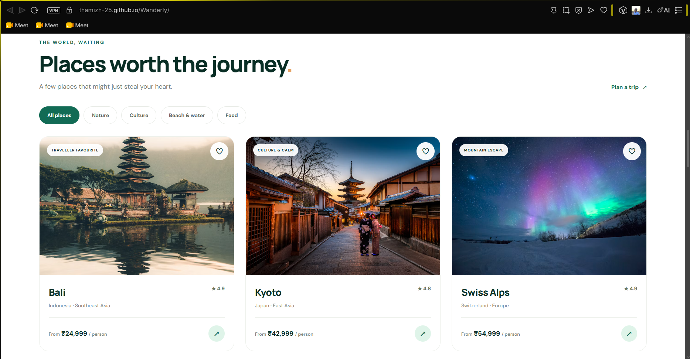
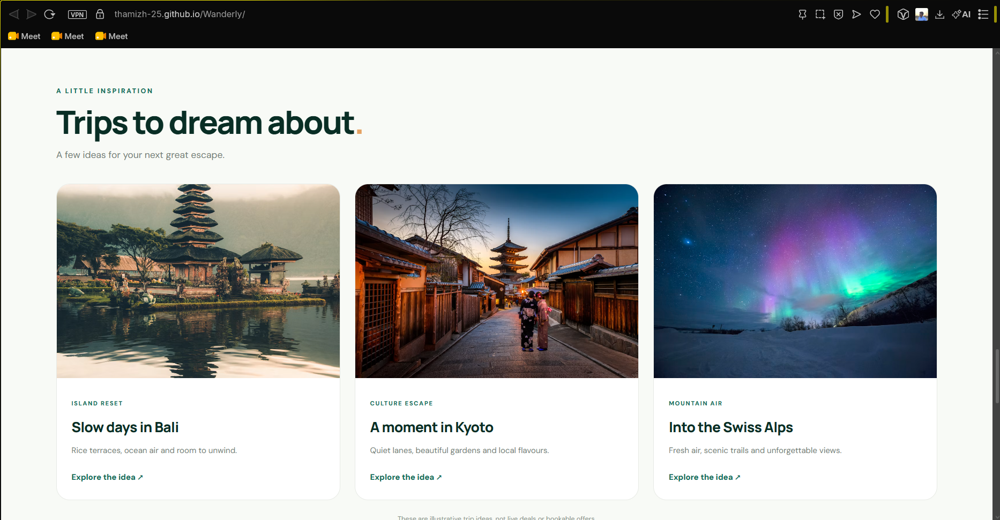
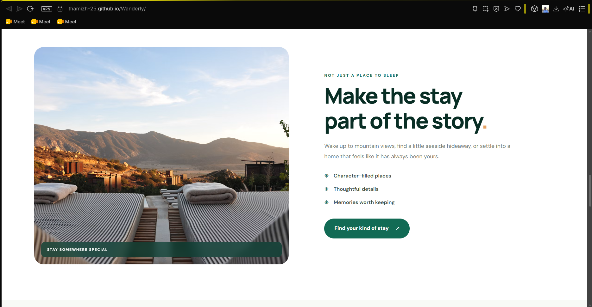
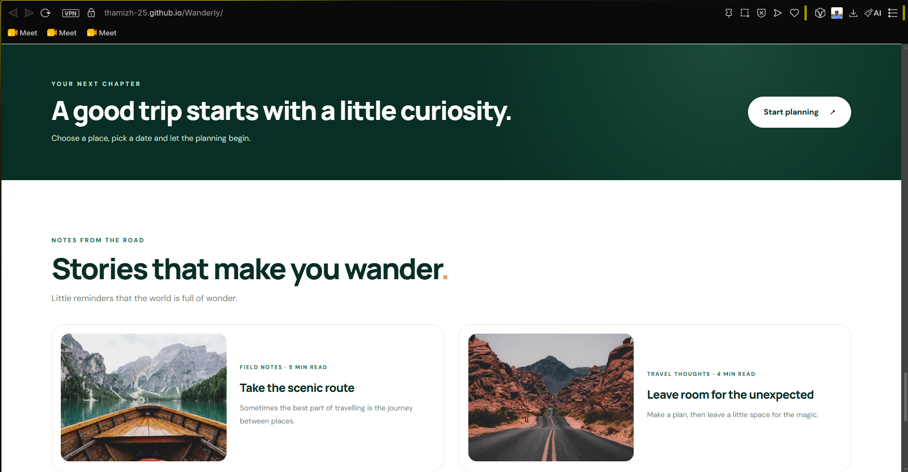
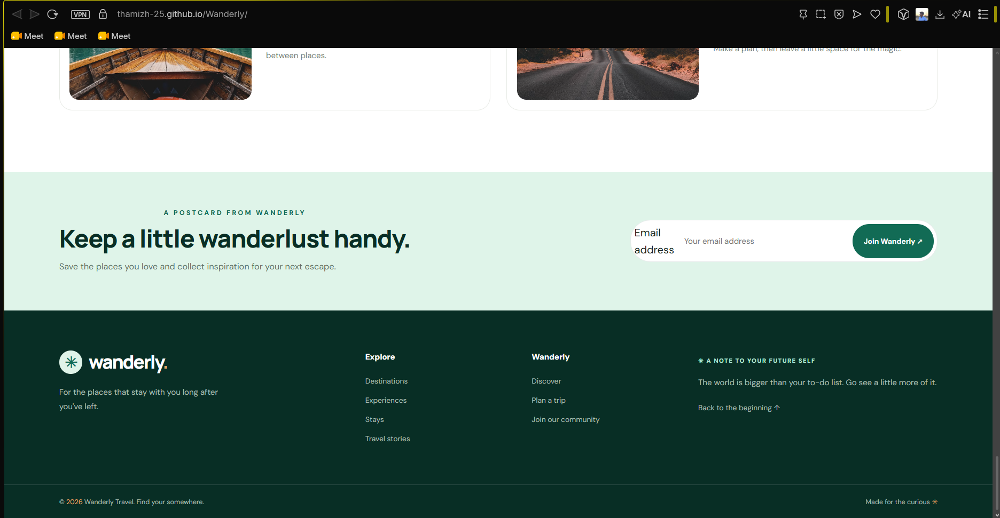

# 🌍 Wanderly — Discover Your Next Adventure

**Wanderly** is a responsive travel discovery website designed to help users explore destinations, discover places to stay, find restaurants, and browse exciting travel experiences through a clean and user-friendly interface.

## 🌐 Live Demo

**Explore Wanderly here:** [Visit Wanderly](https://thamizh-25.github.io/Wanderly/)

## 📂 GitHub Repository

[View source code on GitHub](https://github.com/Thamizh-25/Wanderly)


## ✨ Features

- 🧭 **Navigation Bar** — Easy access to the main sections of the website.
- 🔍 **Search Interface** — Explore travel destinations and discover places of interest.
- 🏝️ **Destination Discovery** — Browse destinations and find inspiration for your next trip.
- 🏨 **Accommodation Listings** — Discover places to stay.
- 🍽️ **Restaurant Discovery** — Explore dining options.
- 🎟️ **Experience Listings** — Browse activities and travel experiences.
- ⭐ **Rating and Price Filters** — Narrow down listings based on available filtering options.
- ❤️ **Favorites** — Interact with favorite travel listings.
- 📱 **Responsive Design** — Designed to adapt to desktop, tablet, and mobile screens.
- 🎨 **Modern UI** — Clean layouts, attractive cards, and a consistent visual style.

## 🛠️ Technologies Used

- **HTML5** — Website structure and content.
- **CSS3** — Styling, layouts, animations, and responsive design.
- **JavaScript** — Interactive elements and client-side functionality.

## 📁 Project Structure

```text
Wanderly/
├── index.html
├── style.css
├── script.js
└── README.md
```

*Additional image, font, or asset folders may be included in the project.*

## 🚀 Getting Started

### Prerequisites

A modern web browser and a code editor such as Visual Studio Code.

### Installation

1. Clone the repository:

   ```bash
   git clone https://github.com/Thamizh-25/Wanderly.git
   ```

2. Navigate to the project directory:

   ```bash
   cd Wanderly
   ```

3. Open the project in Visual Studio Code:

   ```bash
   code .
   ```

4. Open `index.html` in your browser, or use the **Live Server** extension in VS Code to run the website locally.

## 💻 Usage

1. Open the Wanderly website.
2. Browse the available destinations and travel listings.
3. Explore accommodation, restaurant, and experience sections.
4. Use the available search and filtering controls.
5. Interact with supported features to explore travel options.

*Available functionality depends on the features implemented in the current version.*

## 🌐 Repository

GitHub: [Thamizh-25/Wanderly](https://github.com/Thamizh-25/Wanderly)

## 🔮 Future Enhancements

- Integration with real-time travel and accommodation APIs.
- User authentication and personalized profiles.
- Booking and reservation functionality.
- Interactive maps and destination recommendations.
- Backend integration and database support.

## 👨‍💻 Author

**Thamizh Selvan C**

GitHub: [@Thamizh-25](https://github.com/Thamizh-25)

## 📄 License

This project is developed for educational and portfolio purposes. Add an open-source license if you intend to distribute it under specific reuse terms.
## 📸 Project Screenshots

### 🏠 Homepage


### 🌍 Explore Destinations


### 📍 Places and Listings


### ✈️ Trips and Experiences


### 🎯 Promotional Section


### 🌐 Travel Inspiration


### 👣 Footer



---

⭐ **If you like Wanderly, consider starring the repository!**

*Discover places. Explore experiences. Wander more.* 🌍
